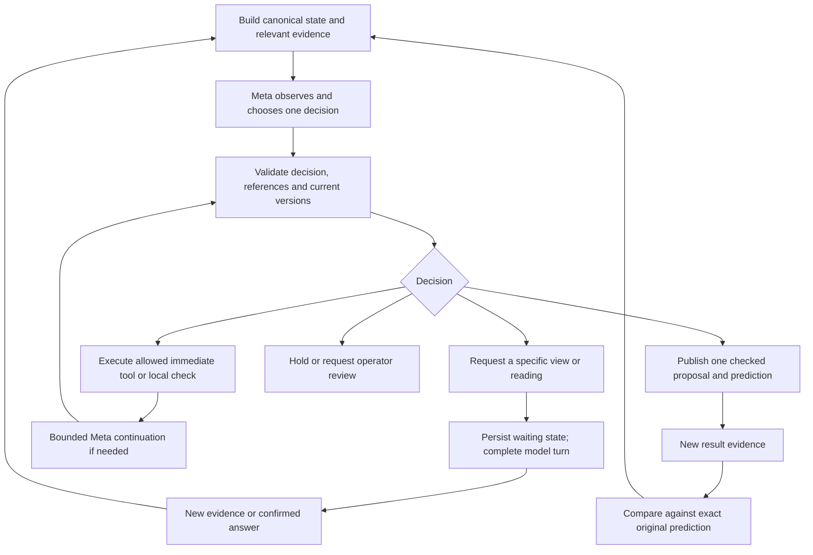

# Meta model usage and agent flow — four-eyes review

**Historical design review:** the required flow actions below now have implementations. See [current implementation](meta-flow-implementation.md) and [implementation four-eyes review](meta-flow-four-eyes-review.md), including the scoped plan-change boundary and remaining optional models.

Reviewed on 3 November 2026. Scope: model selection, role boundaries, context, evidence, tools, memory, verification, recovery and bounded model execution. This document excludes product strategy, submission planning, hosting and physical evaluation plans.

Implementation update: the original-media handoff and exclusive camera decision contract findings below have since been addressed. A canonical camera context now preserves the original prediction independently from the latest comparison image. See [grounded-context implementation progress](meta-grounded-context-progress.md) for the implemented boundaries and remaining request/answer, comparison and recovery work. The findings below record the review before those changes.

Two independent focused reviews and a primary cross-review examined the proposed agent flow against the actual adapters, prompts, schemas and state gates. **25 existing model-adapter/schema regressions passed offline**, with zero failures or skips. No new model requests or production changes were made. Those tests validate the existing integration boundaries; they do not establish that the proposed agent additions are implemented.

**Verdict**

Use one authoritative application controller and one primary Meta reasoning loop. Scene interpretation, planning, comparison and recovery are conditional responsibilities. An extra specialist call should resolve a specific contradiction or reasoning gap. Five sequential role calls are not justified as the default.

The strongest model-native behavior is purposeful evidence acquisition followed by a decision that changes when the evidence changes. The defining loop is:

**Canonical context → observe and decide → permitted tools/checks → request or propose → new evidence → compare with the original prediction → revise or hold.**

**Findings and corrections**

P1 below means required before implementing the proposed flow reliably; P2 is a model-flow improvement. These are design findings, not newly reproduced security defects.

| Priority | Finding | Corrected design |
| --- | --- | --- |
| P1 | Observer-to-planner handoff can lose visual information. Initial `plan()` receives confirmed facts and the structured observation, but only attaches `trialAssets`, which default to empty. A visual relationship omitted by the observer may never reach initial planning. | Retain claim-level source references. Let the planner retrieve bounded relevant source views instead of promoting a summary into scene truth. Revision already attaches trial media. See [plan input](../src/meta/index.ts:245). |
| P1 | The proposed roles have no shared context contract. Separate prompts can disagree about identities, facts or the current prediction. | Build one canonical context package from application records. All roles reference the same state/scene/plan versions and evidence identities; none maintains an independent authoritative plan. |
| P1 | Questions and actions can express mixed intent. The camera schema permits a mandatory `nextAction` alongside free-text `questions`; current prompts discourage contradiction and the engine holds it. | Return one explicit decision type with one matching payload. Keep the engine's uncertainty hold. A request for missing evidence cannot simultaneously authorize a physical move. See [assessment schema](../src/camera/schema.ts:28) and [uncertainty gate](../src/camera/engine.ts:105). |
| P1 | Per-frame observation IDs are not persistent entity identity. | Separate stable `entityId` and physical label from `observationId` and image region. Preserve uncertain matches as hypotheses, and request a discriminating view before merging identities. |
| P1 | A same-model verifier can inherit the planner's assumptions. | Compare the original predicted condition with source evidence and raw readings. Prior model assessments remain hypotheses. Return supported/contradicted/unresolved claims with references; model confidence is not a progression authority. |
| P1 | Recovery could become repeated reformulation on unchanged evidence. | Every recovery names the failed prediction, changed hypothesis, proposed correction and next discriminating observation. With no new evidence or defensible alternative, request information or hold. |
| P1 | A human evidence request is not an immediate function result. | Complete the structured model turn, persist a waiting decision and end the request. When the answer arrives, build fresh canonical context and begin a new bounded turn. Do not leave a provider tool continuation waiting on a person. |
| P1 | Child roles would exceed current call/budget semantics. A tool-round limit also does not bound the number of function calls returned in one response. | Use one aggregate model/tool/token/time budget across all roles and continuations. Each invocation has its own identity and trace; no child silently receives a fresh allowance. |
| P1 | Arbitrary plan mutation conflicts with the current fixed-phase camera engine. Current confirmation advances to the next catalog phase. Fact revision currently resets the view sequence. | Version plan/decision contracts explicitly. Distinguish filling an unknown from changing a confirmed fact; invalidate affected context deliberately. Preserve mandatory obligations and existing commit gates. See [progression](../src/camera/engine.ts:243) and [fact revision](../src/camera/engine.ts:282). |
| P2 | Increasing reasoning effort or adding models does not by itself improve the flow. | Begin with the currently tested Meta model and calibrated camera settings. Add a model/tool or separate specialist only for an identified capability gap. |
| P2 | Camera concision is partly a soft prompt instruction. The prompt asks for at most five observations and three questions, while the current schema permits twelve and eight. | If short responses are a hard interaction requirement, align the schema deliberately and version the contract. This is a concision discrepancy, not evidence of an invalid existing response. |

**Recommended model responsibilities**

| Responsibility | Default execution | Output |
| --- | --- | --- |
| Observe and plan the next decision | One combined Meta turn for a straightforward view. | Grounded observations, unresolved alternatives and one explicit decision. |
| Retrieve or check | Application executes a permitted read/check; Meta can use returned results in a bounded continuation where needed. | Source evidence or deterministic check results. |
| Compare | Usually part of the next after-view Meta turn. | Status of the exact earlier prediction, contradictions and unknown conditions. |
| Recover | A mode of the same loop, or a selective extra pass when the failure warrants it. | Changed hypothesis, targeted correction and next testable prediction. |
| Critique | Optional fresh pass for a consequential contradiction or plan change. | Unsupported claims, missing evidence and conflicts; never a vote that overrides source facts. |
| Coordinate and remember | Application code and structured records. | Authoritative state, ownership, versions, budgets and committed history. |

Different roles can use the same integrated `muse-spark-1.3` model with distinct instructions and allowed tools. Separate credentials or separately hosted agent processes are not necessary for that design. The critique role is a second interpretation, not an independent source of truth.

Dependent reasoning stays serial. Parallel calls are limited to read-only analysis of one immutable context; the controller decides which proposed update can be committed. A separate supervisor model call is unnecessary when application routing and the primary decision already establish the next operation.

**The context every reasoning turn needs**

- Goal, active subgoal, permitted scope and mandatory obligations.
- Run identity, state revision, scene epoch, plan version and input snapshot.
- Operator-confirmed facts separated from model observations and unresolved hypotheses.
- Stable entity labels and exact evidence IDs/hashes, source type and capture-time provenance.
- Current/reference images identified separately. Archived source retrieval remains historical context; receiving an extracted frame now does not make its original scene current.
- The original action/prediction, expected visible result and stop condition.
- Raw reported readings, actual negative reviews and their original limits. Current facts must not be replaced by an old review's snapshot.
- Available decisions/tools, remaining aggregate budget and stopping conditions.

The existing camera path already provides current/reference images, hashes, confirmed facts and the last three reviews from the same phase/scene. The proposed additions are stable entity memory, explicit hypotheses/predictions, structured evidence requests and bounded evidence retrieval. Summaries may help pack context but cannot replace original counterevidence or become confirmed facts. Request concise decision rationale and alternatives, not hidden chain-of-thought.

**Decision and tool contracts**

The logical decision set should be:

```ts
type DecisionKind =
  | 'request_view'
  | 'request_measurement'
  | 'propose_action'
  | 'propose_plan_change'
  | 'ready_for_operator_review'
  | 'hold';
```

For the provider wire format, preserve the tested closed, shallow strict-JSON approach. A conceptual TypeScript union is not proof that a top-level union schema is supported. Use a closed root containing the decision type and required nullable payload fields if necessary; local cross-field validation must require exactly the matching payload and reject contradictory branches. This proposed extended schema still needs its own contract verification before being represented as supported.

A request includes `requestId`, target entity IDs, the needed view or `factKey`, why it matters and the hypothesis/decision it resolves. A proposal includes preconditions, current evidence references, targets, expected result, stop conditions and dependent plan identity. Comparison includes `predictionId`, `supported_by_view | contradicted | unresolved`, evidence references and failed/unknown conditions. A plan change identifies its exact parent and the counterevidence that requires it.

Tool permissions remain narrow:

- Read owned evidence by validated IDs and bounded timestamps/regions; never arbitrary paths or URLs.
- Run deterministic constraint checks; applicable mandatory checks run even if Meta does not ask for them.
- Use the existing checked planning/compilation path for supported plan changes.
- Return a request for user evidence as a decision; it does not silently capture another image or authorize another paid call.

There is no model-callable tool to overwrite confirmed facts, relax a bound, skip obligations or commit completion. Model proposals pass schema, ownership, reference, freshness and state-version checks before publication. These gates are distinct from whether the model's interpretation is correct.

**Corrected turn flow**



On an after-view, comparison can be performed inside the same combined Meta decision call. The separate diagram box is a responsibility, not a mandatory additional provider request.

**Model request and execution details to preserve**

- Meta endpoint and the currently integrated model selection. The compatible SDK is transport; inference is sent to Meta.
- Strict `text.format` output followed by local schema and reference validation.
- Current camera baseline: `reasoning.effort: 'low'`, a 6,000-output-token ceiling, a 90-second request timeout and zero automatic retries. The earlier 1,600-token request exhausted its reasoning budget; reducing it casually would repeat a known failure. These are current settings, not guarantees for the extended flow.
- Only the verified `tool_choice: 'auto'` where tools are supplied. The existing planner removes tools for finalization rather than sending unsupported named/required/none choices.
- Function results paired with the provider's `call_id`, with authoritative instructions resent on continuations.
- Rechecks immediately before paid calls and continuations, plus final local validation before committing results.
- Provider response identity and actual known usage retained before rejecting malformed/incomplete content. An unknown interrupted outcome stays unknown and is not retried blindly.

Each role invocation needs its own `modelInvocationId`, parent invocation, role/model/prompt/schema/tool versions, context hash, response IDs and usage. Reserve a budget once per actual invocation before POST, not once per trace callback: the current camera adapter deliberately invokes the pre-request trace callback twice. Aggregate known usage by unique response identity and tool execution by response/call identity. Keep unknown usage explicit. A trace update is not another billed invocation.

**Focused checks before implementing this as complete**

- An unreadable identity produces a targeted request instead of a guessed action.
- An omitted visual relation can be recovered from the original referenced evidence.
- A prior confident model statement cannot turn missing evidence into a fact.
- An after-view is compared with the exact original prediction, not a newly rewritten target.
- A failed reported reading changes the next decision and remains in history.
- Repeated identical evidence cannot sustain an unlimited recovery loop.
- Answering a request does not accidentally restart the run or silently overwrite confirmed facts.
- Scene, fact or plan changes invalidate dependent model context and late outputs.
- Embedded instructions in images/notes cannot change the allowed tools or authoritative rules.
- Every specialist and continuation shares the same bounded budget and preserves its trace.

**Recommended implementation order within the model flow:** establish the shared context/decision contracts; preserve source-evidence retrieval across handoffs; implement completed evidence-request/wait/answer turns; compare exact predictions and retain counterevidence; add selective recovery/critique; extend aggregate budgeting and invocation traces before enabling extra calls. Keep these additions explicit: they are proposed improvements, while the existing camera assessment and jig checker loop already work under their narrower contracts.
