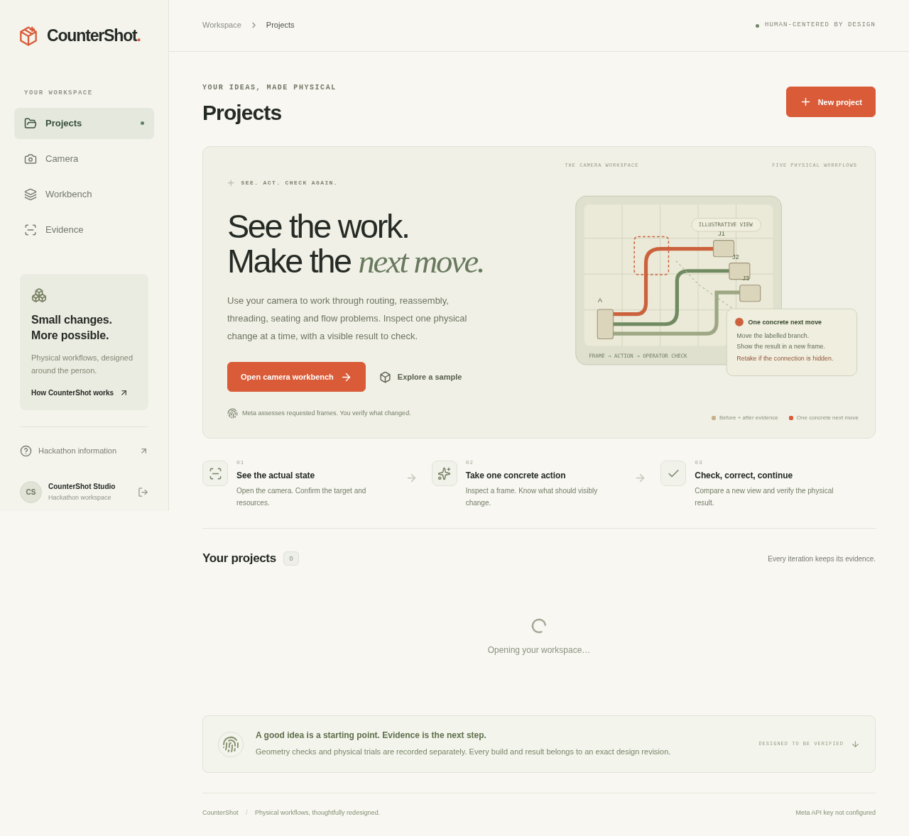

# Verification — camera workbench and jig companion

Software review rechecked on 3 November 2026; actual Meta evaluation records below are from 2 November 2026. These are software/API checks on synthetic camera scenes and supplied-panel inputs. Successful physical operation and comparative benefit have not been demonstrated.

## Current checks

- **271 automated tests passed**, zero failed or skipped: 35 camera domain tests, 22 camera API regressions, 11 camera Meta tests, four isolated camera still-media tests and 199 geometry/state, ownership, job, media, upload, storage and audit tests.
- **TypeScript passed.**
- **Production build passed** compilation, type checking and route generation without warnings.
- **20 Chromium browser journeys passed**, with a clean exit against the final optimized production build: ten camera journeys and ten workshop/history/upload/mobile journeys. Camera regressions cover permission/track lifecycle, measured failure and outline tolerance, historical criteria, watch limits, cancellation, stale response ordering, transport/processing freshness, image-load failure and interrupted-session upgrades. The isolated test server had no worker or provider key. No provider requests were made by browser tests.
- Previously observed on 2 November: the workshop HTTP smoke passed jig parts/setup/print/manifest downloads, project ownership rejection, nonconforming build handling and incomplete alignment-evidence persistence, without another model request.
- Previously observed on 2 November: synthetic MP4/PNG HTTP upload, duration/decode validation, byte-exact protected retrieval and forged-type rejection passed. Still/short synthetic media checks do not establish a real complete assembly cycle.
- The backend **Docker image built and ran locally** with the web and queue processes and a fresh persistent volume. A reproduced parallel-startup SQLite lock was fixed with a startup WAL retry; a separate-process regression holds a competing writer during initialization.
- Previously observed on 2 November: a **trusted local HTTPS hybrid smoke** passed through separate frontend/direct-API origins against the Docker backend. A generated MOV of **5,425,995 bytes** bypassed a frontend proxy enforcing a 4.5 MiB request limit, produced an **89,717-byte MP4**, and retained its exact original/hash. Secure session/access cookies, scoped one-use uploads, CORS, private retrieval/ranges and replay/origin/ownership denials passed. After a backend restart, the same project and original/canonical bytes remained accessible with the same private session. No model job or physical trial was created. This local proxy exercise is not an actual Vercel deployment or a real-phone camera test.

The [3 November independent review](four-eyes-review-2026-11-03.md) reproduced and corrected camera, model-context, browser-timing, media and construction defects, including the interrupted upgrade reset. It made no live Meta calls. The earlier camera build made seven separately recorded synthetic-image requests, including a retained failure and one paired-image probe. Current camera engine 1.2.0 and prompt 1.0.2 were checked offline; those historical calls were not rerun or attributed to the updated prompt. Aggregate compiler 3.0.2 includes legacy precision fixes; the workshop-specific compiler remains 3.0.1. Earlier fixtures and SVG examples remain unchanged historical evidence.

The subsequent [UI simplification](ui-simplification.md) also passed the final optimized build and all 20 browser journeys. Twelve responsive checks covered home, camera setup and workshop upload at 320, 390, 768 and 1440 pixels. These interface checks made no new Meta requests.

## Five camera iterations

The [camera verification record](camera-verification.md) contains the exact per-workflow outcomes, review fixes and evidence limits. Five actual Muse Spark 1.3 assessments returned in **6.679–11.165 seconds**. All remained nonactionable/nonconfirmable under uncertainty gates; the fragment orientation cue remained unresolved, and two proposed actions with unanswered questions were held. These are strict API-contract results on rendered diagrams, not five successful physical tasks.

An additional actual paired-image check correctly recognized the corrected harness routes in **6.370 seconds** while still withholding physical admission. All seven known requests used **31,038 tokens**, with actual response IDs and the failed attempt preserved.

The final reviewed Docker image built and ran with web and queue processes. Actual private HTTP checks verified all five profiles under engine 1.2.0, response timing, ownership denial and no-key HTTP 503 without fabricated turns/reviews. The same private sessions survived restart on the isolated persistent volume. Real-device and public deployment checks remain outstanding.

## Actual Meta jig planning

The successful workshop run used **Meta Muse Spark 1.3** with synthetic fixed-panel measurements. It produced **23 actions, six braces and an explicit removable gate**, corrected access/target errors and a self-dependency over **three checker rounds**, and returned a completed strict proposal that passed current checks and compiled.

The actual run took **149,724 ms across four completed responses**. The full input/output/usage/tool trace is in [recorded-meta-workshop-plan.json](../fixtures/recorded-meta-workshop-plan.json). No proposed program was manually repaired, and no physical trial record was created. Current runtime additionally compacts duplicated feedback context; that optimization was checked offline, not claimed as a new measured latency result.

Two earlier workshop attempts failed and were rejected. The first exhausted the tool budget before intermediate CLI audit persistence existed; its response IDs/usage are unknown. The next exposed a quoted-null function-argument issue and later returned HTTP 503; its known usage and unknown final-request outcome are preserved separately. The adapter now submits jig-only tool arguments, reports precise schema errors and removes tools for final structured completion after checks pass. Failed attempts were not relabelled as successes. See [detailed integration evidence](meta-integration.md) and the safe local summaries at ignored `data/verification/meta-workshop-attempts.json`.

## Concrete reliability findings corrected

- Adjacent gate notches must retain the same intervening material web in both checker and compiler.
- Gate/support identities cannot collide with the base blank.
- Finished output cannot occupy a declared next-cycle stock pickup.
- An unfinished wall needs its actual matching bracing duty; a locate-only feature or imaginary helper cannot substitute.
- A hand carrying the removed gate must park it before extracting the workpiece.
- A measured alignment error beyond the built snapshot's tolerance fails even if a reviewer checks alignment as passing. Editing current tolerance cannot relabel an old build's result.

An additional local adversarial mutation exercise found no compiler disagreement among 527 checker-passed variants from 900 tested mutations. This is consistency evidence within the bounded code, not manufacturing or physical validation.

## Evidence still required

1. An actual compatible pre-cut panel set and a visible baseline holding/alignment conflict.
2. Actual dimensions, joint windows, operator capabilities and material calibration.
3. A built exact generated jig; hand release at every locate-to-join boundary; complete joints, gate parking, extraction and reset.
4. Measured alignment, every attempt/intervention, and a consequential tested revision.
5. Fair ordinary-aid/direct-assistant comparisons and a frozen held-out case before claiming a comparative or adaptation advantage.

The [build brief](workshop-build-brief.md) provides the concrete part family, materials, measurements, first admission test and comparison plan. No jig/material/force envelope is physically admitted by these software results. Participant Official Rules and final submission-portal requirements remain distinct from the public event-page descriptions.

## Actual application outputs

[Jig design view](screenshots/design.png), [mobile view](screenshots/mobile.png), [jig cut/score parts](examples/jig-parts.svg) and [assembly/release setup](examples/jig-setup.svg) come from the running application on clearly labelled synthetic inputs. They are proposed construction outputs, not a real completed enclosure or physically tested jig.

[Camera workbench on phone](screenshots/camera-workbench-mobile.png) and [desktop](screenshots/camera-workbench-desktop.png) use a labelled synthetic browser fixture and mocked assessment. They show the implemented interface, not a real physical trial.
